# 海斗助手 Hexaram｜海克斯大乱斗助手

<p align="center">
  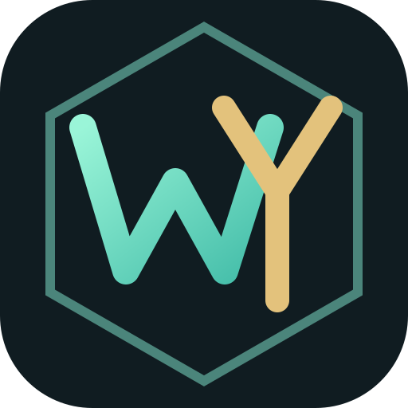
</p>

**查战绩、选海克斯、复盘每一局。**

面向英雄联盟国服玩家的 Windows 桌面助手。围绕海克斯大乱斗，把个人战绩归档、英雄与强化表现、选人推荐和对局复盘放在一起：选人时看看池里哪些英雄自己更擅长，对局中了解双方近期表现，打完后回看这一局的数据。

[下载最新版](https://github.com/doujiaoshaorou/hexaram/releases/latest) · [更新记录](https://github.com/doujiaoshaorou/hexaram/releases) · [问题反馈](https://github.com/doujiaoshaorou/hexaram/issues)

**快速导航：** [我的战绩](#我的战绩) · [战绩查询](#战绩查询) · [英雄表现](#英雄表现--我的海克斯) · [英雄梯度](#英雄梯度) · [标签与自动标签](#标签与自动标签) · [对局与推荐](#对局与推荐) · [AI 复盘](#ai-复盘) · [安装与使用](#安装与使用) · [常见问题](#常见问题)

## 功能一览

| 功能 | 解决什么问题 |
| --- | --- |
| 我的战绩 | 回看自己的近期对局与归档统计，进入十人详情复盘 |
| 查询 | 查询其他召唤师的战绩、近期表现与标签 |
| 英雄表现 / 我的海克斯 | 看自己哪些英雄和强化用得多、表现如何 |
| 英雄梯度 | 浏览 OP.GG 海克斯英雄强度，打开英雄查看强化推荐 |
| 标签管理 | 查看默认标签条件，管理自定义标签及启用状态 |
| 自动标签 | 根据近期战绩和规则识别玩法特点，辅助理解玩家表现 |
| 对局与推荐 | 选人时参考共享池与个人胜率，查看双方阵容和近期战绩 |
| AI 复盘 / AI 标签推荐 | 按需调用模型分析对局，或生成可选择采用的标签建议 |

## 战绩与英雄表现

### 我的战绩

「我的战绩」绑定当前账号，将个人资料、本地归档统计与逐场战绩放在同一页。查看近期表现后，可打开具体一局，继续查看十名玩家的结算数据、装备与强化。

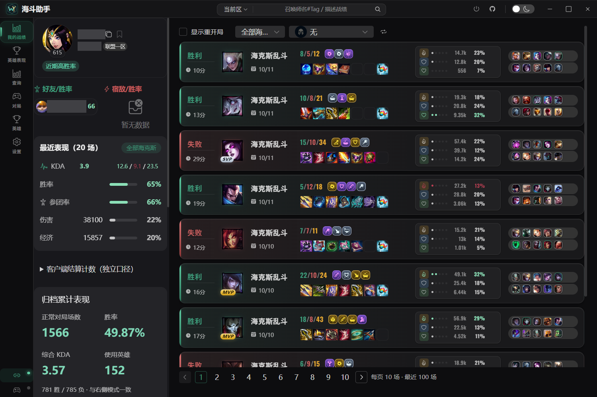

### 战绩查询

在顶部选择大区并输入完整的 `召唤师名#Tag`，查看其他玩家的近期战绩。查询页保留自己的结果与模式选择，方便在自己的战绩和其他玩家之间切换；退出查询可点击「关闭查询」。

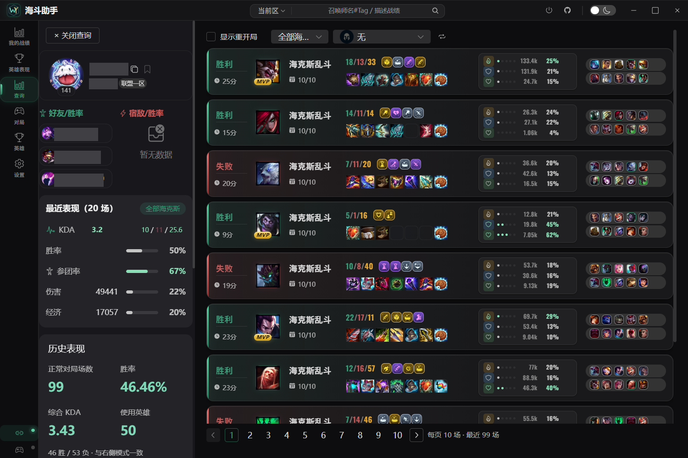

| 入口 | 可以查看什么 |
| --- | --- |
| 我的战绩 | 当前账号的本地归档、正常对局场数、胜负、归档胜率与综合 KDA |
| 查询 | 按大区与完整召唤师 ID 查询其他玩家的近期战绩 |
| 对局列表 | 每页 10 场，近期查询支持最近 100 场分页 |
| 十人详情 | 查看单场双方玩家的数据、装备与海克斯强化，结合具体对局复盘 |

统计默认排除重开局，累计数以实际取得并归档的明细为准。

### 英雄表现 / 我的海克斯

按所选海克斯模式、日期范围查看数据，也可以切换累计表现或最近 20 / 50 / 100 场。

- **英雄表现**：逐个英雄查看场数、胜负、胜率和 KDA，支持搜索、最少场数筛选及排序，并可跳转查看对应对局。
- **我的海克斯**：查看强化的使用场数、胜率，以及相对同英雄整体胜率的差异；支持按英雄筛选。
- **样本提示**：强化少于 10 场会标记低样本。同场同一强化只计一次，多枚强化分别计入；胜率差反映历史相关性。
- **OP.GG 梯队**：提供海克斯英雄梯队与强化推荐，可与自己的历史表现一起参考。

<details>
<summary>查看英雄表现完整界面：场数、胜率、KDA 与筛选</summary>

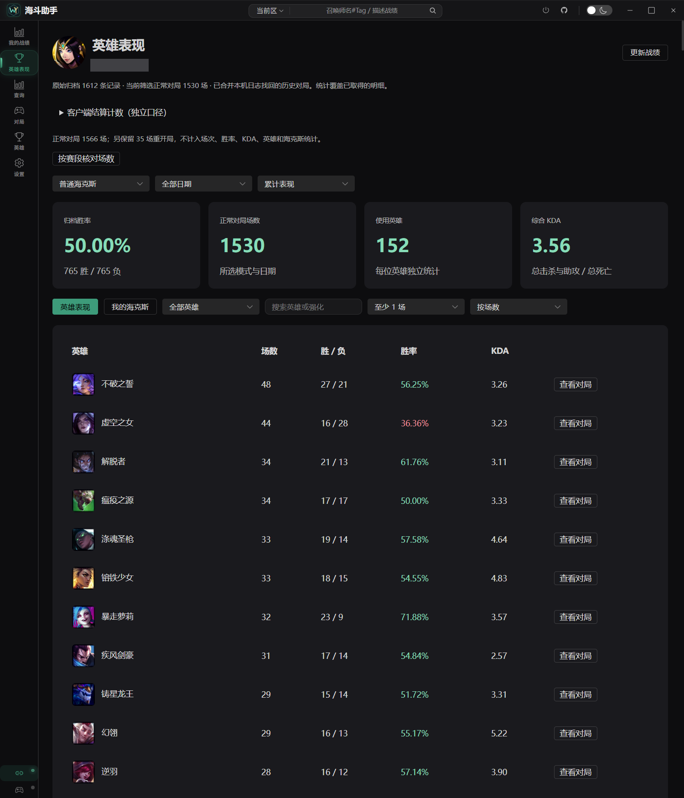

</details>

### 海斗表现与玩法标签

WY 海斗表现分基于近期正常对局估算个人表现；玩法标签结合出装和实际作用辅助阅读战绩。**WY 表现分是本项目的实验性评分，不是官方隐藏分。** MVP / SVP 沿用 Rank Analysis 的七维评分，两者口径不同。

<p>
  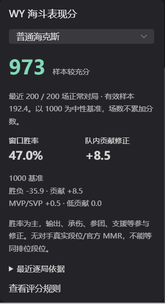
  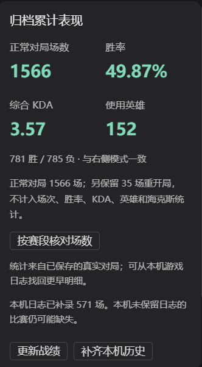
</p>

## 英雄梯度

侧栏「英雄」打开独立的「海克斯英雄强度」页面，用于浏览 OP.GG 海克斯英雄榜单。

- **英雄梯队**：按榜单展示英雄强度，支持搜索英雄和刷新数据。
- **英雄详情**：点击英雄打开侧边详情，查看该英雄的海克斯强化推荐。
- **版本与时效**：页面标注榜单版本，数据滞后时给出提示，便于判断参考时效。
- **与个人表现对照**：榜单评级来自 OP.GG；自己的英雄胜率在「英雄表现」中查看。

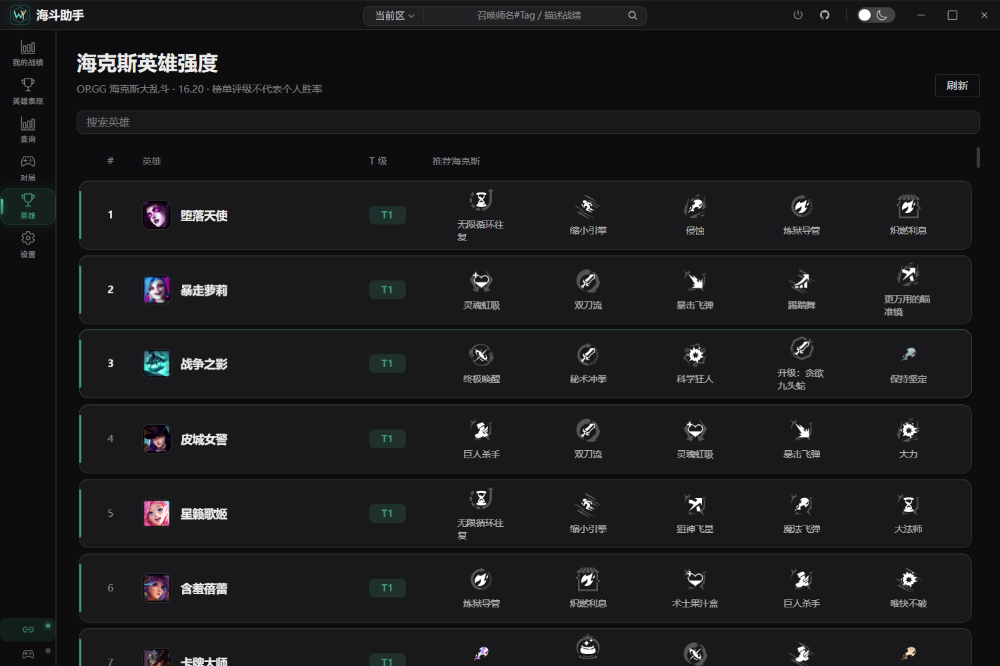

## 标签与自动标签

### 标签管理：查看规则与自定义标签

打开「设置 → 标签管理」，可以查看标签名称、描述、默认状态和启用开关。

- **默认标签**：点击「查看」了解具体触发条件。
- **自定义标签**：支持新增、编辑和删除，配置名称、描述、正负类型与条件组合。
- **按需启用**：可单独启用或关闭某个标签。
- **从内置规则开始**：查看内置标签后点击「复制为自定义」，或在新增标签时选择内置规则模板；全部阈值和逻辑均可继续编辑。
- **完整条件编辑**：支持分模式判定、AND / OR / NOT、最多 200 场窗口、有效样本门槛、单局组合条件、综合 KDA 和英雄类型分布。

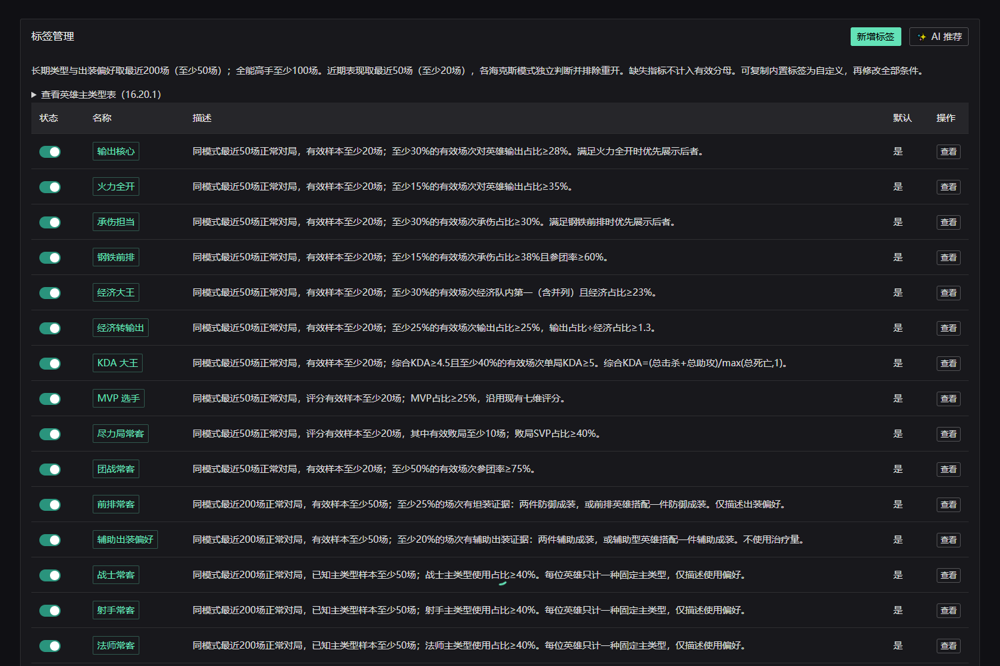

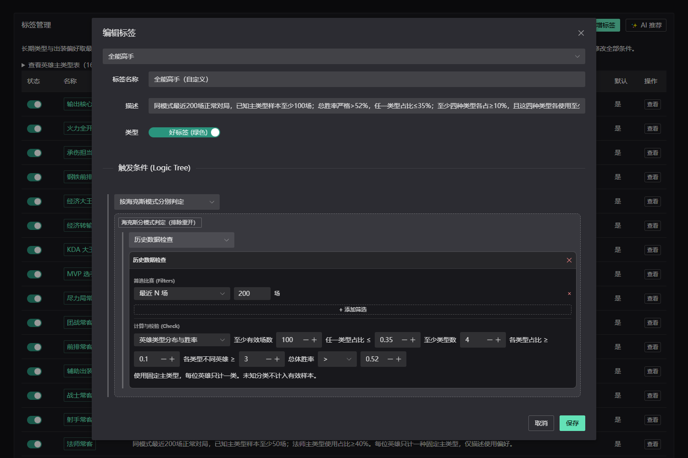

*标签两图由新版实际 Vue 组件在本地预览环境中呈现，使用内置规则，不含玩家数据；其他图片为桌面软件截图。*

### 自动标签：根据战绩判定玩法特点

启用的标签通过规则匹配战绩，用于辅助阅读玩家表现。玩法判断将出装偏好与实际作用分开，结合可用明细识别特点。

- **长期偏好**：英雄类型、出装偏好统计最近 200 场，至少 50 场；战士、射手、法师、坦克、刺客、辅助各有「常客」标签，使用占比达到 40% 时触发。
- **近期表现**：输出、承伤、经济、KDA、MVP/SVP、参团及胜率采用最近 50 场，至少 20 场；SVP 另要求至少 10 场有效败局。连胜连败从最新一场连续判断，至少 3 场。
- **全能高手**：最近 200 场、至少 100 场已知分类对局，总胜率严格高于 52%；任一类型占比不超过 35%，至少四类各占 10%，这四类各使用至少三位不同英雄。
- **模式与分类**：各海克斯模式分别计算，排除重开；英雄固定主类型采用 Riot Data Dragon 的首个类型，可在标签页查看分类表。
- **证据不足**：缺少所需字段的对局不计入对应有效分母，不补猜；治疗不再用于内置标签。两个旧风险标签保留但默认关闭。
- **可解释条件**：可在标签管理中查看规则。标签反映数据中的特征，仅用于游戏复盘参考。

### AI 标签推荐：生成建议后选择采用

标签管理中的「AI 推荐」可分析近期战绩，分别给出赢局与输局的特点建议。有效建议由用户选择采用，也可以重新生成；采用后作为自定义标签管理。

规则自动标签不需要模型生成。AI 标签推荐需要配置模型服务，会发送分析所需数据并消耗服务额度。

### 玩家备注与标记

在玩家卡片中添加备注与标记，再到「设置 → 我标记过的人」统一查看和管理。

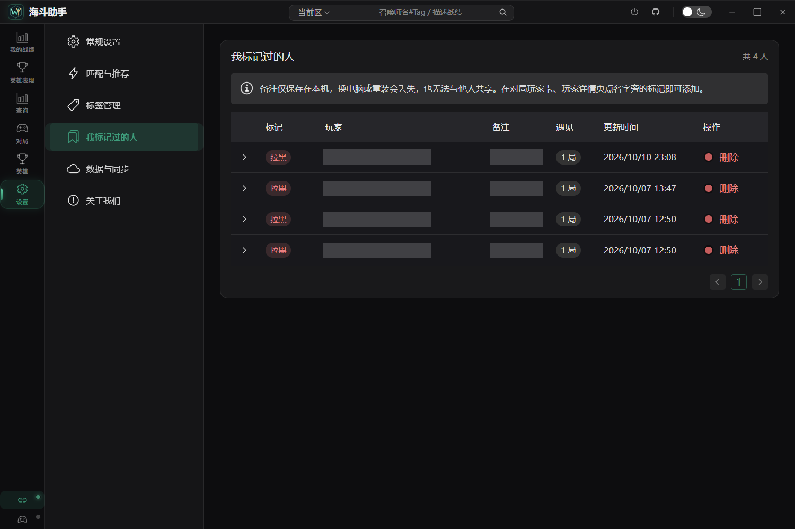

## 对局与推荐

### 匹配设置与个人英雄池

在「设置 → 匹配与推荐」按需设置自动接受对局或自动开始匹配，并查看个人常用、高胜率及低胜率英雄。英雄选择和交换由你在游戏客户端中完成。

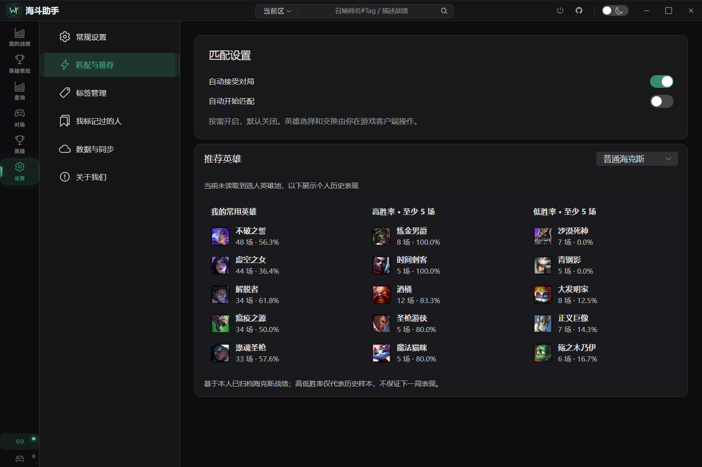

### 选人阶段：从当前英雄与共享池中挑选

- **当前英雄与共享池**：进入海克斯选人阶段后读取可用英雄，每 5 秒刷新。
- **个人英雄池推荐**：结合本人已归档的海克斯战绩，分开展示常用英雄、高胜率英雄和低胜率英雄；高低胜率列表要求至少 5 场样本。
- **队友当前英雄**：展示队友所选英雄，便于商量交换；实际交换由你在游戏客户端中完成。
- **海克斯强化推荐**：展示 OP.GG 强化评级与稀有度，便于快速浏览。个人强化胜率可在「英雄表现 → 我的海克斯」查看。

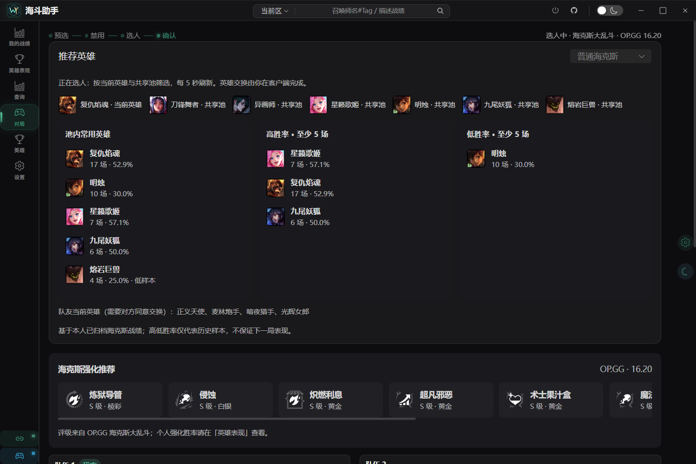

*上图为海斗助手的选人界面。个人历史胜率与 OP.GG 评级分别展示；历史样本不保证下一局表现，截图中的数据与版本号仅代表截图时的状态。*

### 双方阵容：一屏查看十名玩家的近期表现

- 按我方、对方分栏展示英雄、近期战绩、KDA 与胜率。
- 通过胜负颜色、近期英雄和连胜等标签，快速了解双方近期状态。
- 结合实时阵容与个人历史，为选人和后续复盘提供参考。

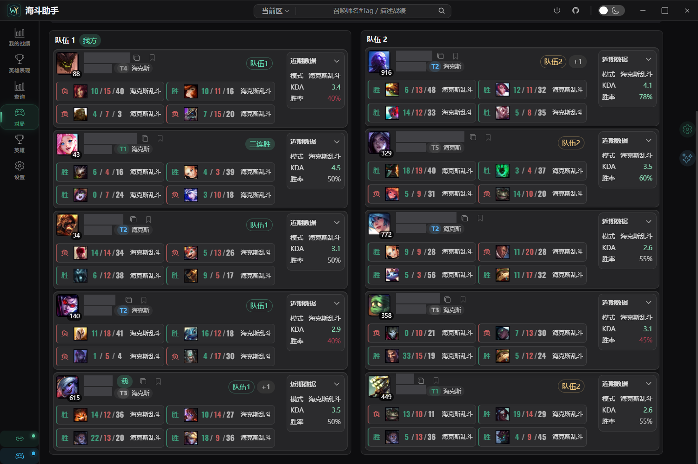

*上图中十名玩家的昵称和完整数字 Tag 均已用不透明色块遮挡，其余界面与数据保持原图。*

## AI 复盘

支持 **DeepSeek** 和 **通义千问（DashScope）**。在设置中选择服务商并配置自己的 API Key 后，可使用对局分析能力，结合结算和可用事件数据辅助复盘。

- 基础战绩、统计与推荐不要求配置 AI Key。
- 点击 AI 分析会向所选服务发送相应对局数据，并消耗该服务的调用额度。
- 分析基于可取得的数据，没有录像；对操作过程和胜负原因的判断仅供参考。

## 安装与使用

### 首次使用

1. 前往 [下载最新版](https://github.com/doujiaoshaorou/hexaram/releases/latest)，下载 `Hexaram-版本号-win-x64.exe`。
2. 将程序放到一个可写的独立目录。运行环境为 **Windows x64 + WebView2**，无需为成品程序安装 Node.js 或 Rust。
3. 启动英雄联盟国服客户端并完成登录，再打开海斗助手，等待客户端连接。
4. 在「我的战绩」查看本人数据，按需点击「更新战绩」；查询他人时，选择对应大区并输入完整的 `昵称#Tag`。
5. 进入海克斯选人阶段后打开「对局」，查看英雄池与强化推荐；赛后从战绩列表打开单场详情。

### 更新与保留数据

将新版放在原目录，保留同目录的 `hexaram-data/` 和 `hexaram-config.yaml`，以沿用本机归档与配置。

从 **0.9.0** 起，可在「设置 → 关于我们」检查更新、查看更新记录和设置自动下载。下载完成后点击确认重启安装，程序不会在对局中自动重启。0.8.1 及更早版本需要先手动下载一次 0.9.0 或更新版本。

每个版本的具体变化请查看 [更新记录](https://github.com/doujiaoshaorou/hexaram/releases)。

## 常见问题

**为什么累计场数与掌盟或客户端不一致？**

历史覆盖取决于客户端接口与本机可恢复记录，不保证全生涯完整。模式、日期、重开局排除规则也会影响统计口径。请先核对筛选条件与已归档范围。

**为什么推荐列表里没有某个英雄，或者没有胜率？**

选人时推荐范围为当前英雄与共享池。个人归档不足时可能没有胜率；高低胜率列表至少需要 5 场。未读取到选人英雄池时，页面改为展示所选模式的个人历史表现。

**OP.GG 评级是不是我的个人胜率？**

不是。OP.GG 评级来自外部榜单，个人胜率来自本机归档，两者分别展示。查看自己的强化使用表现，请打开「英雄表现 → 我的海克斯」。

**不配置 AI Key 能用吗？**

可以。AI 复盘是可选能力，基础战绩查询与统计不依赖 AI 服务额度。

**换电脑或分享软件时应保留哪些文件？**

本人换机时妥善备份程序同目录的 `hexaram-data/` 和 `hexaram-config.yaml`。向他人分享软件时只分发 Release 附件，不要附带自己的配置、API Key 或战绩目录。反馈截图时请遮挡玩家昵称与完整 Tag。

## 问题反馈

欢迎通过 [GitHub Issues](https://github.com/doujiaoshaorou/hexaram/issues) 提交问题或建议。请附上软件版本、操作步骤、预期与实际结果，以及已打码的截图，方便复现。

## 来源与作者

基于 [wnzzer/Rank Analysis](https://github.com/wnzzer/rank-analysis) 二次开发，沿用 Vue / Tauri / Rust 架构与客户端、战绩等能力。作者 **doujiaoshaorou**，使用 **GPT-6 Astra** 辅助开发。本项目是独立衍生版本，不是 RA 官方发行版，亦非 Riot Games 或 OP.GG 官方产品。

保留原作者版权与 [MIT 许可证](LICENSE)，详见 [第三方说明](THIRD_PARTY_NOTICES.md)。

## 开发与构建

源码在 `rank-analysis-app/`，需要 Node.js、Rust stable MSVC、Windows C++ Build Tools 和 WebView2。

```powershell
cd rank-analysis-app
npm ci
npm run dev
# 桌面开发 / 正式构建
npm run tauri dev
npm run tauri build -- --no-bundle
```

应用采用当前程序目录保存本机配置与归档。分享时仅分发 Release 附件，不要上传自己的配置、API Key 或战绩目录。

[开发与发布](docs/development/publishing.md) · [验证记录](docs/validation/README.md) · [历史开发笔记](docs/history/development-notes.md)
